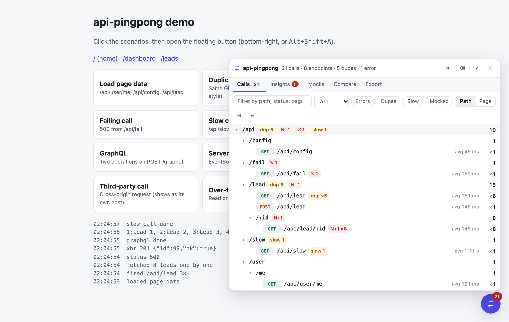
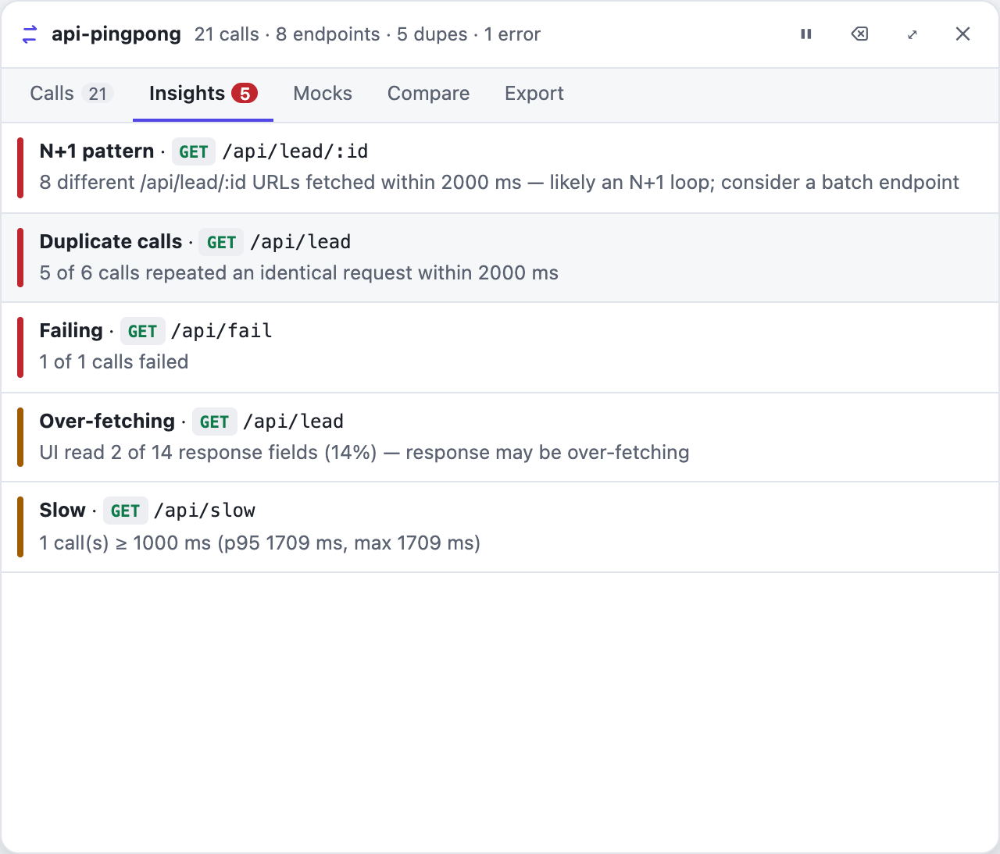
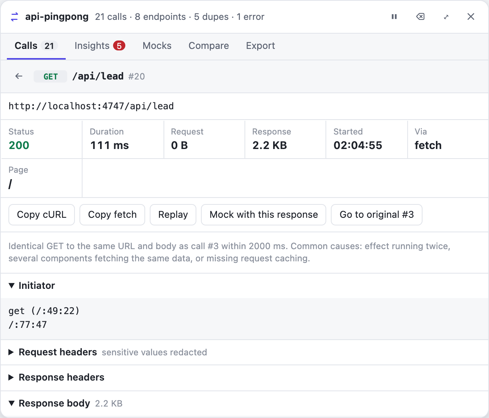

# api-pingpong

A framework-agnostic floating devtool that records every API call your app makes, groups them into a **path tree** (`/api → /lead → /:id`), and flags **duplicate**, **N+1**, **slow**, **failing** and **over-fetching** calls.

Works with React, Vue, Angular, Svelte, Solid or plain JS, and with any HTTP client: `fetch`, axios (XHR), ky, SWR, React Query, Apollo and others. WebSocket, EventSource and `sendBeacon` are recorded too.

**Add-ons included:** mock responses and network failures · replay · copy as cURL/fetch · snapshot compare · JSON/HAR export and import · OpenAPI and TypeScript generation · GraphQL grouping · initiator trace · over-fetch hints · browser extension. [See all add-ons ↓](#add-on-features)



| Insights | Call detail |
|---|---|
|  |  |

## Install

```sh
npm i -D api-pingpong
```

## Use

Add one line. It must run **before** your app makes requests, so put it first in your entry file.

```js
// Dev only: the dynamic import is dropped from production bundles.
if (import.meta.env.DEV) import('api-pingpong/auto');
```

Or with options:

```js
import { init } from 'api-pingpong';

init({
  enabled: process.env.NODE_ENV !== 'production',
  position: 'bottom-right',
  trackFieldUsage: true,
});
```

Without a bundler, add a script tag as the first script in `<head>`:

```html
<script src="https://unpkg.com/api-pingpong/dist/api-pingpong.auto.global.js" data-position="bottom-left"></script>
```

Toggle the panel with the floating button or **Alt+Shift+A**. The button can be dragged, and its position is remembered. On SSR (Next.js, Nuxt) `init()` is a no-op on the server.

## Core features

| | |
|---|---|
| **Path tree** | Calls are grouped by normalized path. Numeric IDs, UUIDs, Mongo ObjectIds, ULIDs, hashes, dates, emails and long tokens collapse to `:id`, `:uuid` and similar. Third-party hosts get their own branch. |
| **Call counts** | Every folder and endpoint shows how many times it was called, so repeated calls stand out immediately. |
| **Duplicate detection** | The same method, URL and body within `duplicateWindowMs` (2 s by default) is flagged, and every call in the burst links to the original. Catches effects that run twice, several components fetching the same data, and aggressive polling. |
| **N+1 detection** | Many *different* URLs for one pattern in a short burst (for example `/lead/1…/lead/8` right after `/lead`). |
| **Filters** | Search by path, status, page or GraphQL operation, filter by method, and narrow to errors, duplicates, slow or mocked calls. |
| **Isolation** | The UI lives in Shadow DOM, so your CSS can't break it and it can't break yours. It works on mobile and in webviews. |

## Add-on features

Beyond listing and counting calls, api-pingpong includes tools for debugging, testing, sharing and documenting your API usage.

### Find problems

| Add-on | What it does | Where |
|---|---|---|
| **Insights** | One ranked list of everything worth fixing: duplicates, N+1 bursts, slow endpoints, failing endpoints and over-fetching. Click an item to jump to the endpoint. | **Insights** tab |
| **Timing stats** | avg / p50 / p95 / max per endpoint. Calls slower than `slowThresholdMs` (1 s by default) are flagged. | Endpoint view |
| **Initiator trace** | The app stack frame that started each call (`LeadList.tsx:42`). Library and `node_modules` frames are skipped. | Call detail |
| **Group by page** | Groups calls by the route the user was on (`/dashboard` → which APIs), including client-side `pushState` navigation. | **Path / Page** toggle |
| **GraphQL awareness** | Calls are grouped by operation (`query GetLeads`, `mutation SaveLead`) instead of one big `/graphql` bucket. Automatic persisted queries (APQ) are supported. | Calls tab |
| **Over-fetch hints** | Opt-in (`trackFieldUsage: true`). Compares the response fields the UI actually read with what the API returned, for example "UI read 2 of 14 fields". | Insights tab, call detail |
| **WebSocket / SSE / beacon** | WebSocket and EventSource connections are listed with every message sent and received. `sendBeacon` analytics pings are recorded too. | Call detail → Messages |

### Debug and test

| Add-on | What it does | Where |
|---|---|---|
| **Copy as cURL / fetch** | Copies any call as a ready-to-run command. Secrets stay redacted by default. **Copy cURL + auth** includes the real `Authorization` and cookie headers; these are kept in memory only and never exported. | Call detail |
| **Replay** | Re-sends a call with its original headers and body. The replay is recorded and linked to the original. | Call detail, endpoint view |
| **Mock responses** | Override status and body, simulate a **network error** (`status: 0`), or add **latency** to a real response, all without touching the backend. Presets cover 500, 404, network error, slow (3 s) and empty list. Rules match a pattern (`/api/lead/:id`), a concrete path, a full URL or a `*` wildcard. Works for fetch and XHR (axios), and persists across reloads. | **Mocks** tab, or **Mock with this response** on any call |
| **Pause recording** | Stop recording without reloading. Requests still go through untouched. | ⏸ in the header |

### Compare, share and document

| Add-on | What it does | Where |
|---|---|---|
| **Snapshot compare** | Take a snapshot, change your code, then diff call counts, duplicates and latency per endpoint, for example "`/api/lead` went from 7 calls to 1". Snapshots survive reloads. | **Compare** tab |
| **Export / import** | Download a recording as JSON or HAR and attach it to a bug report; a teammate can import it into their panel. HAR files saved from Chrome DevTools import too. Sensitive values are redacted. | **Export** tab |
| **OpenAPI spec** | Generates an OpenAPI 3 spec from observed traffic: path params, query params, request bodies, and responses by status code. | **Export** tab |
| **TypeScript types** | Generates request and response types for each endpoint from real payloads, with optional and nullable fields inferred. | **Export** tab (download or copy) |

### Convenience

| Add-on | What it does |
|---|---|
| **Keyboard shortcut** | **Alt+Shift+A** toggles the panel. Configurable with `hotkey`, or turn it off with `false`. |
| **Draggable button** | Drag the floating button anywhere; its position is remembered, and the panel opens next to it. |
| **Expanded view** | ⤢ switches to a large, centered panel for long lists and big response bodies. |
| **Light and dark themes** | Follows the system color scheme. |
| **Browser extension** | Use the panel on any site (staging, production, sites you don't own) without changing their code. See [Browser extension](#browser-extension-zero-code). |

## Options

| Option | Default | |
|---|---|---|
| `enabled` | `true` | Set `false` to skip everything. |
| `position` | `'bottom-right'` | Initial button corner. |
| `open` | `false` | Start with the panel open. |
| `hotkey` | `'alt+shift+a'` | Use `false` to disable. Modifiers: `ctrl`, `alt`, `shift`, `meta`. |
| `maxCalls` | `2000` | Ring buffer size. |
| `duplicateWindowMs` | `2000` | Window for duplicate and N+1 detection. |
| `nPlusOneThreshold` | `5` | Distinct URLs in one burst that count as N+1. |
| `slowThresholdMs` | `1000` | |
| `captureBodies` | `true` | Request and response bodies (text/JSON only; binary and streams are skipped). |
| `maxBodySize` | `100000` | Characters per body. |
| `redact` | `true` | Redact sensitive headers and JSON keys in the UI and in exports. |
| `redactHeaders` / `redactBodyKeys` | | Added to the built-in lists (`authorization`, `cookie`, `x-api-key`… / `password`, `token`, `secret`…). |
| `normalizeRules` | `[]` | `[{ test: /^acme$/, replace: ':org' }]`, tested per path segment before the built-ins. |
| `ignore` | `[]` | Strings (substring) or RegExps. Matching URLs are not recorded. |
| `intercept` | all `true` | `{ fetch, xhr, beacon, websocket, eventSource }` |
| `trackFieldUsage` | `false` | Turns on over-fetch hints (see [Add-on features](#add-on-features)). |
| `persist` | `true` | Store mocks, snapshots and UI state in `localStorage`. |
| `zIndex` | `2147483000` | |

## Programmatic API

```ts
const pp = init();
pp.getCalls();                       // readonly ApiCall[]
pp.subscribe(() => …);               // returns unsubscribe
pp.addMock({ method: 'GET', match: '/api/lead/:id', status: 500, body: '{"error":"x"}' });
pp.pause(); pp.resume(); pp.clear();
pp.exportHAR(); pp.exportJSON();
pp.open(); pp.close(); pp.toggle();
pp.destroy();                        // restores fetch/XHR/WebSocket/EventSource/sendBeacon
```

Pure helpers are exported too: `normalizePath`, `toCurl`, `toFetchSnippet`, `toHAR`, `parseImport`, `toOpenAPI`, `toTypeScript`, `computeEndpoints`, `computeInsights`, `buildTree`.

## Browser extension (zero code)

`extension/` is a Manifest V3 extension built on the same code. Enable it per site from its popup. It injects before the page's own scripts, so it works on staging or production sites you don't control.

```sh
npm run build    # also copies the bundle into extension/
```

Then open `chrome://extensions`, turn on Developer mode, choose **Load unpacked**, and select the `extension/` folder.

## Demo

```sh
npm run demo     # http://localhost:4747
```

A zero-dependency demo server with scenario buttons: duplicates, N+1, failures, slow calls, XHR, GraphQL, SSE, beacon, a third-party call, and over-fetching.

## Limitations and notes

- **Import early.** Calls made before `init()` runs aren't seen. The script-tag and extension builds patch before anything else runs.
- **Service workers.** Requests a service worker makes on its own aren't visible. Page requests that a service worker answers are.
- **Field usage is a heuristic.** It covers `fetch().json()` only, because axios parses XHR text itself. Code that walks every key (`JSON.stringify`, deep-equal, React Query structural sharing) marks everything as used.
- **Initiator frames point at bundled code** when there are no source maps. Vite and webpack dev servers usually give readable paths.
- Recording keeps request and response bodies in memory. It's a dev tool, so keep it out of production builds.

## Development

```sh
npm test         # vitest: unit tests plus a happy-dom integration suite
npm run typecheck
npm run build    # ESM + CJS + .d.ts + minified IIFE builds (~27 KB gzipped)
```

## License

MIT
